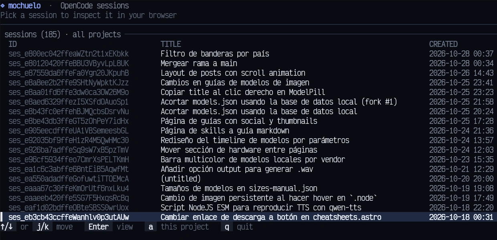

# mochuelo

Inspect [OpenCode V2](https://opencode.ai) sessions in your browser.


`mochuelo` reads `opencode` sessions and turns into a interactive report. With no arguments it opens an interactive picker with the sessions of the current project or all projects.



## Install

```sh
# Install Rust + cargo
curl --proto '=https' --tlsv1.2 -sSf https://sh.rustup.rs | sh

# Install mochuelo
cargo install --git https://github.com/manzdev/mochuelo
```

## Usage

```sh
mochuelo                  # interactive picker; press s for global stats
mochuelo <session-id>     # serve the session and open the browser
mochuelo <session-id> -o report.html   # export into a standalone HTML report
```

### Global statistics (TUI)

Press `s` in the session picker to open aggregate usage:

- `Tab` / `g` `m` `w` `d`: Global, Monthly, Weekly or Daily.
- Submenu, oldest to newest: months (`June 2026` → `November 2026`),
  weeks (`16N-22N`, Monday–Sunday) or days (`15/Nov` → `22/Nov`).
- `←` / `→` (or `h` / `l`): previous / next month, week or day.
- `-` / `+` (or `[` / `]`): older / newer page of the submenu.
- `r`: reload.
- `Esc`: back to sessions; `q`: quit.

The view shows total input + output first, then input tokens with nested cached
input and uncached input (both with percentage), output tokens, messages, cache
multiplier, total cost (with cost/1M in parentheses), active session duration
and session count.

Statistics are aggregated per message by its own timestamp, so a session that
spans several days contributes each day only its own tokens, cost and messages.
Session duration is active time: gaps between consecutive user/assistant
messages, with pauses longer than 5 minutes capped at 5 minutes.

Monthly, Weekly and Daily views also show an `activity` panel above usage: a
contribution grid of squares, one per month/week/day, shaded darker for less
total tokens and lighter for more. There are no labels or legend; the selected
period is marked with yellow brackets. Global has no activity grid.

### Options

```
-o, --output <FILE>  Write a standalone HTML file instead of starting the server
    --no-open        Don't open the page in the default browser
    --port <PORT>    Port for the local server (0 = random free port)
    --stdout         Print the HTML to stdout instead of serving or writing it
    --version        Show version
```

Ctrl+C stops the server.

## The page

- Summary of project.
- Stats: messages, tools, tokens and cost.
- User prompts and replies.
- Tool calls and shell `command` inputs and outputs.
- Client-side filter (`/`)
- Responsive layout, dark/light theme

## Notes

- Requires the `opencode` CLI installed in `PATH`.
- Cost breakdown reads the cached models.dev catalog from the same database. If pricing is missing for a model, the card shows the total without the split.
- Global statistics include all non-archived sessions. A session with zero recorded cost is estimated from its tokens and the cached pricing catalog.
- Only data present in the export is shown; tool outputs are truncated at 120k characters per block to keep pages reasonable.
- The server binds to `127.0.0.1` only.

## License

- MIT license
- Created by [ManzDev](https://manz.dev/)
- [Inteligencia Artificial](https://ai.manz.dev/)
