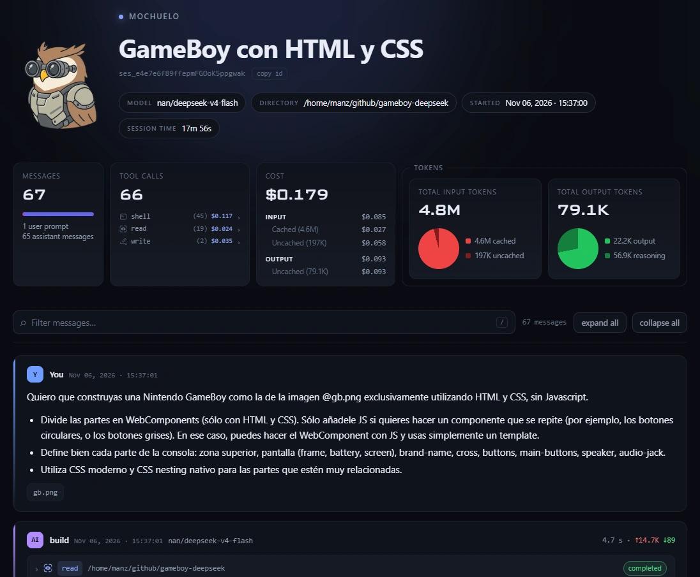

# mochuelo

Inspect [OpenCode V2](https://opencode.ai) sessions in your browser.



`mochuelo` reads `opencode` sessions and turns into a interactive report. With no arguments it opens an interactive picker with the sessions of the current project or all projects.


## Install

```sh
# Install Rust + cargo
curl --proto '=https' --tlsv1.2 -sSf https://sh.rustup.rs | sh

# Install mochuelo
cargo install --git https://github.com/manzdev/mochuelo
```

## Usage

```sh
mochuelo                  # interactive picker (↑/↓ or j/k, Enter, a, q)
mochuelo <session-id>     # serve the session and open the browser
mochuelo <session-id> -o report.html   # export into a standalone HTML report
```

### Options

```
-o, --output <FILE>  Write a standalone HTML file instead of starting the server
    --no-open        Don't open the page in the default browser
    --port <PORT>    Port for the local server (0 = random free port)
    --stdout         Print the HTML to stdout instead of serving or writing it
    --version        Show version
```

Ctrl+C stops the server.

## The page

- Summary of project.
- Stats: messages, tools, tokens and cost.
- User prompts and replies.
- Tool calls and shell `command` inputs and outputs.
- Client-side filter (`/`)
- Responsive layout, dark/light theme

## Notes

- Requires the `opencode` CLI installed in `PATH`.
- Cost breakdown reads the cached models.dev catalog from the same database. If pricing is missing for a model, the card shows the total without the split.
- Only data present in the export is shown; tool outputs are truncated at 120k characters per block to keep pages reasonable.
- The server binds to `127.0.0.1` only.

## License

- MIT license
- Created by [ManzDev](https://manz.dev/)
- [Inteligencia Artificial](https://ai.manz.dev/)
